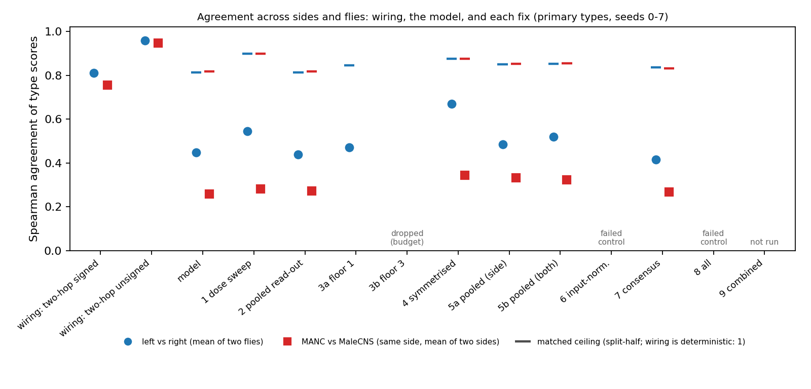

# Does a fly nerve-cord simulation agree with itself? A ten-minute brief (BrainIR prediction ledger, run 4)

## What was tested, and how

A model that simulates the fly's ventral nerve cord from its connectome (the published rate model behind the DNg100 walking result) can
screen descending-neuron types: stimulate a type, ask whether the front-leg motor neurons become rhythmic. We used agreement between a
type's left and right copies, and between two flies (the MANC and MaleCNS connectomes), as a consistency check: if the screen captures
function shared by copies built by the same genome, they should agree about as well as the screen agrees with itself across random seeds
(the ceiling; agreement is a Spearman correlation of type scores). Real sides and individuals can differ, and the two connectomes differ
in reconstruction and annotation (MaleCNS's descending-neuron sides were reassigned from their outputs; its neurons carry MANC types by
matching), so a gap is a warning about the screen, not proof of an error.

Analyses, thresholds and pass/fail criteria were frozen before any simulation of this run (`PREREG_v4.md`, tag `ledger-prereg-v4`,
Bitcoin-timestamped). Both gaps had been seen in an earlier run (Part A reuses its MANC seeds 0-3; the rulebook's Part Q lists
everything seen before the freeze); result 1 had not been computed. Departures from the rulebook are recorded in `AMENDMENTS_v4.jsonl`
(code fixes made before the analyses they touch, cost settings, a timeout, and a budget cut of the analysed types from 278 to 262), and
the pre-registered budget rule dropped some analyses. GitHub and Modal each reproduced 100 locked jobs exactly before use, and every
result-bearing campaign passed a digit-for-digit determinism check (20 re-run jobs each). No exam label entered Parts A-C (the fixes'
only experimental anchor was DNg100, their positive control); labels were used to turn scores into forward-ledger probabilities and,
exploratorily, to re-score an earlier exam with the fixes (nothing here rests on that).

## Three results

**1. The authors' own published scores disagree between left and right.** In their single-neuron screen (128 replicates per neuron), a
neuron's left and right copies agree at **0.63** of the screen's agreement with itself (95 % interval 0.53-0.72); of 7 and 8 driver
types on the two sides, exactly one is a driver on both. *Caveat:* their screen stimulates one neuron and reads out both legs together.

**2. Our simulation shows a similar gap in both flies, but not the same one, and a larger gap across flies.** Left against right reaches
**0.59** (MANC) and **0.64** (MaleCNS) of the ceiling, comparisons across flies 0.32-0.50; same-side cross-fly pairs agree no better
than opposite-side pairs (difference -0.04, -0.10 to +0.02), so the flies' left-right differences are not shared. Type-level wiring
summaries correlate at 0.71-0.98 (deterministic, not ratios to a ceiling), but about half of the connections between matched neurons
exist on one side only. *Caveat:* stimulating one side and reading that side is our procedure; result 1 shows the gap without it.

**3. Poisson-scale noise in synapse counts moves the screen almost as much as the left-right difference does.** In MANC, two copies of
the network that differ only by Poisson noise in their raw synapse counts (before the 5-synapse floor) agree at **0.40** (Spearman; 0.48
of their ceiling), almost as poorly as left and right in the same paired design (0.37; 0.47 of the ceiling; result 2's 0.59 comes from
another design). With no fitted parameter, this meets the pre-registered test (left-right minus copy-copy -0.03, interval -0.16 to
+0.10); so does the second pre-registered noise model, a negative binomial whose dispersion was estimated from homologous left-right
connection pairs (0.45). A post-hoc check by the adversarial reviewer over all pairings of the four stored copies (two Poisson, two
negative binomial; not under either lock; `results/RESULTS_3.md` section 3.4) suggests most of the gap, not demonstrably all. *Caveat:*
noise of this size suffices, which does not make the real left-right differences count noise; MANC only, because MaleCNS is published
already floored.

## Why the two sides disagree, and what fixed it or did not

- **The procedure explains part at most.** Scoring the best of a fixed grid of currents instead of the tuner closes 0.36 of the gap in
  MaleCNS (0.08-0.61) and 0.17 in MANC (-0.07 to 0.38, not distinguishable from 0). But the grid score is also less noisy (ceiling 0.85
  to 0.95 in MaleCNS, 0.77 to 0.84 in MANC): against its own ceiling, agreement in this 8-seed design rises only from 0.58 to 0.65 and
  from 0.52 to 0.55. At matched currents the sides still disagree (all 19 in MANC; the 12 conclusive ones in MaleCNS).
- **Not one place in the network (MANC).** Mirroring only the stimulated neurons' own outputs closes 0.23 of the gap (-0.01 to 0.42),
  only the downstream network 0.34 (0.10 to 0.53); in MaleCNS 0.17 and 0.21, both intervals including 0. Mirroring both closes the gap
  by construction, so the parts (sum 0.56) interact.
- **Partly small one-sided connections and unpartnered neurons (MANC).** Mirroring connections present on one side only closes 0.29
  (0.06-0.49), unpartnered neurons 0.25 (0.06-0.42); most one-sided connections have 1-4 synapses on the other side, below the floor.
  Weights, size and sign alone close less (0.09, 0.03, -0.05; every interval includes 0), but by the pre-registered reading weights and
  size contribute in combination (all but the weights mirrored: 0.55; all but size: 0.81; both intervals below 1); sign does not; the
  classes interact.
- **No fix worked.** Of the ten variants of fixes 1-8, eight kept the DNg100 control and six were judged on all four criteria (a dose
  sweep instead of the tuner, a pooled read-out, symmetrised weights, two type-pooled variants, consensus annotations); all failed, the
  two flies reaching only 0.31-0.39 of the ceiling against 0.8 required. Floor 1 could be judged only on MANC's left-right agreement,
  floor 3 was dropped for budget, input normalisation and the combined network fixes broke the control, and the combined
  procedure-plus-network fix (9) was not run. The rewired-driver criterion (at most 2) was set on another regime and was hard to meet,
  but every judged fix fails the agreement criterion anyway.

**What this work does not show.** It does not show that a real fly's two sides behave differently, nor that the model is wrong about
DNg100's own walking circuit. It covers excitatory descending-neuron types whose left and right copies are annotated homologs (MANC 307
of 321 types, MaleCNS 219 of 328, 215 in both; Parts B and C a budget-cut 261 and 203). Nothing was tested in an animal. Our ceilings
rest on 8-16 seeds, and most single-cause estimates have wide intervals.

## The decisive experiments, and the ask

The forward ledger (tag `ledger-forward-v1`) gives, for 63 descending-neuron types with a driver line and no clear label, the
probability of rhythmic front-leg stepping in a decapitated fly from two sources: the authors' model and two-step signed synapse
counting (no fix passed). The probabilities, fitted to the earlier exam's labels (training on past results), are weak (leave-one-out
Brier: model 0.248, counting 0.239, base rate 0.242; AUROC 0.33, below chance, and 0.61). Most of the 39 fit types were labelled in
intact flies (21 of 25 "yes" from one atlas), so these are extrapolations, made after the exams were unblinded but before the
experiments they predict.

| type | driver lines listed as available | P(rhythmic): authors' model (its screen score) | P(rhythmic): two-step counting |
|---|---|---|---|
| DNg43 | 2 of 4: SS66182, SS68371 | 0.72 (0.04) | 0.44 |
| DNp56 | 1 of 2: SS88245 | 0.76 (0.13) | 0.50 |
| DNg32 | 1 of 1: R50E12 | 0.59 (0.00) | 0.80 |
| DNp34 | 0 of 3 | 0.59 (0.00) | 0.80 |
| DNp45 | 1 of 1: SS81831 | 0.59 (0.00) | 0.76 |
| DNp35 | 0 of 2 | 0.59 (0.00) | 0.45 |
| DNp26 | 7 of 10: R29G08, SS81818 +5 more | 0.69 (0.01) | 0.81 |
| DNg87 | 0 of 1 | 0.70 (0.02) | 0.80 |
| DNad006 | 0 of 1 | 0.59 (0.00) | 0.69 |
| DNg91 | 3 of 4: SS94997, SS58304 +1 more | 0.59 (0.00) | 0.68 |
| DNp31 | 8 of 8: R58E07, SS00733 +6 more | 0.59 (0.00) | 0.50 |
| DNg78 | 5 of 11: SS13337, SS72084 +3 more | 0.59 (0.00) | 0.65 |
| DNg39 | 2 of 6: SS64882, SS70659 | 0.76 (0.12) | 0.82 |
| DNp44 | 2 of 2: SS64688, SS66153 | 0.68 (0.01) | 0.73 |
| DNp15 | 2 of 4: SS01556, SS12653 | 0.59 (0.00) | 0.54 |

These are the 15 types on which the sources disagree most (the rulebook's "decisive experiments"), yet only by 0.05-0.28, so one
experiment per type separates them weakly. The model column is the authors' screen score passed through the fit: 9 of the 15 score 0 (no
rhythm), which the fit maps to 0.59, near the base rate (0.64), and none is a driver in the screen (highest score 0.13), so the Brier
comparison tests the calibration, not the screen's own call. No line is listed as available for DNp34, DNp35, DNg87 and DNad006 (public
catalogues, checked 2026-11-22; `forward/AVAILABILITY.csv`), and ten "available" entries rest on an untested FlyBank status page. Seven
available lines have at least one kit record naming another descending-neuron type (SS01553, SS01588 and SS82228 for DNp26; SS58304 and
SS95034 for DNg91; SS88264 for DNg78; SS12653 for DNp15; `kit_v2/driver_lines.csv`): prefer the other lines, and read a positive result
from these as possibly joint activation.

**The ask.** Express CsChrimson under these lines (LexAop-CsChrimson for a LexA line), decapitate, feed all-trans-retinal, give 1-s
light pulses, and score rhythmic front-leg stepping blind to genotype. Each source will be scored by its Brier score against a base-rate
guesser.

## Where everything is

Branch `ledger/v1`, folder `research/ledger/`. Tags, each with a `LOCK_*.json`: `ledger-prereg-v4` (rulebook), `ledger-reliability-v2`
(results 1-3, causes, fixes), `ledger-forward-v1` (forward ledger), `ledger-labels-v2` (driver-line kit). Under no lock: the amendments
file (committed), the adversarial reviewer's post-hoc check (cited in words only) and the post-lock exam re-scores (hashes in `LOG.md`
L148). Full results `results/RESULTS_3.md`; each claim's source `EVIDENCE_MAP.md`; reviews and answers `reviews_v4/`.

*Raw Spearman agreement of type scores (not the ratios above; Part C design: seeds 0-7, cut type set), left vs right (blue) and across
flies (red), for the wiring, the unfixed model and each fix; bars mark the matched ceiling; wiring points are deterministic.*
