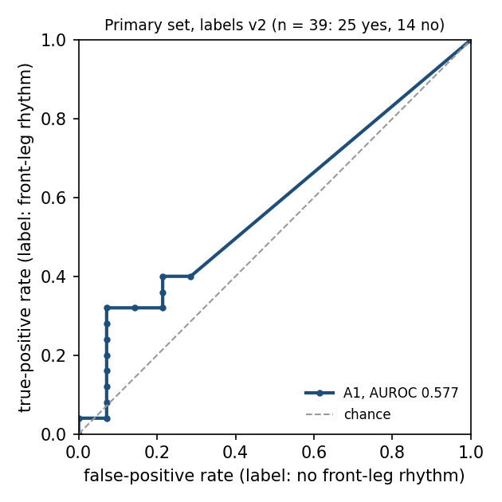
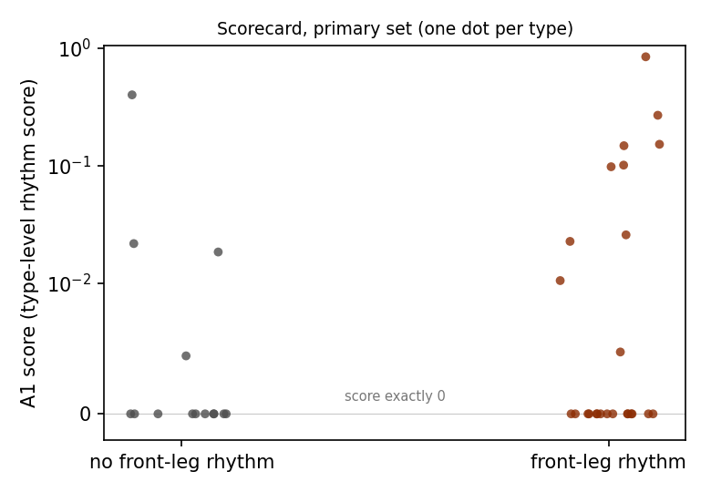

**Pre-registered verdict: the model does not predict front-leg rhythm in the fly.** On the 39 types of the primary set (25 with front-leg rhythm, 14 without) A1, the authors' type-level co-activation screen, reaches an AUROC of 0.577 (95 % interval 0.417 to 0.724, one-sided permutation p = 0.182); the interval includes 0.5. The analysis is not underpowered, and A1 does not add value beyond wiring: the best anatomical baseline scores higher.

# BrainIR prediction ledger, results 1 (run 2)

Labels v2 (`LOCK_labels_v2.json`) against predictions v1 (`LOCK_predictions_v1.json`) and v2 (`LOCK_predictions_v2.json`), scored by the frozen pipeline after the unblinding gate held on all six conditions (`gates_v2/UNBLINDING_GATE_run2.json`). Runs: P (primary), S-a (labels v1.1), S-b (PREREG v1 secondary analyses), S-c (new arms); each run once (`results/run2/*.json`). Rules: `PREREG.md` sections 7-8, `PREREG_v2.md` Part S.

## Headline (run P)

| quantity | value |
|---|---|
| types in the primary set | 39 (25 yes, 14 no) |
| AUROC of A1 | 0.577 |
| 95 % stratified bootstrap interval (10,000, seed 20261120) | 0.417 to 0.724 |
| one-sided permutation p (10,000, seed 20261121) | 0.182 |
| decision rules | underpowered: False; the model predicts: False; adds value beyond wiring: False |

Independent check: a fresh subagent recomputed the primary AUROC from the locked files with its own code (see below).

## Bands (run P)

| band of A1 | types | label agrees | rate |
|---|---|---|---|
| driver | 1 | 1 with front-leg rhythm | precision 1.00 |
| non-driver | 32 | 13 without front-leg rhythm | negative predictive value 0.41 |
| indeterminate | 6 | | |

## Baselines (run P, anatomical baselines S1-S8 of PREREG v1 3.5)

| baseline | AUROC |
|---|---|
| S1_direct_mn | 0.310 |
| S2_twohop_signed | 0.669 |
| S3_twohop_abs | 0.091 |
| S4_total_out | 0.114 |
| S5_out_partners | 0.093 |
| S6_premotor | 0.103 |
| S7_n_members | 0.634 |
| S8_informed | 0.309 |

Paired comparison with the best baseline (S2_twohop_signed): A1 minus baseline = -0.091 (95 % interval -0.320 to 0.150, seed 20261122). Against the informed baseline: 0.269 (0.057 to 0.473). Several wiring baselines score far below 0.5, i.e. they rank the wrong way.

## Controls (run S-b): the ten control networks, B1's procedure

| control | AUROC |
|---|---|
| B1-ctl-classshuffle-201 | 0.580 |
| B1-ctl-classshuffle-202 | 0.304 |
| B1-ctl-classshuffle-203 | 0.566 |
| B1-ctl-classshuffle-204 | 0.409 |
| B1-ctl-classshuffle-205 | 0.417 |
| B1-ctl-rewire-101 | 0.554 |
| B1-ctl-rewire-102 | 0.609 |
| B1-ctl-rewire-103 | 0.497 |
| B1-ctl-rewire-104 | 0.513 |
| B1-ctl-rewire-105 | 0.501 |
| mean (min to max) | 0.495 (0.304 to 0.609) |

A1 (0.577) lies inside the range of the shuffled and rewired control networks.

## Secondary tables

| analysis | n | yes / no | AUROC | 95 % interval | note |
|---|---|---|---|---|---|
| intact preparations only (S-b) | 38 | 26 / 12 | 0.598 | 0.429 to 0.750 |  |
| headless preparations only (S-b) | 3 | 0 / 3 | n/a | n/a | no yes type |
| clean lines only (S-b) | 13 | 1 / 12 | 0.375 | 0.250 to 0.500 |  |
| non-specific lines (S-b) | 34 | 29 / 5 | 0.593 | 0.400 to 0.741 |  |
| systematic sources only (S-b) | 32 | 25 / 7 | 0.623 | 0.411 to 0.800 |  |
| exposed types included (S-b) | 50 | 28 / 22 | 0.510 | 0.363 to 0.656 |  |
| exposed types only (S-b) | 11 | 3 / 8 | 0.583 | 0.125 to 1.000 |  |
| never-usable types excluded (S-b) | 37 | 23 / 14 | 0.596 | 0.432 to 0.745 |  |
| labels v1.1 (run S-a) | 12 | 1 / 11 | 0.909 | 0.727 to 1.000 | underpowered (1 yes); p 0.172 |
| single-neuron screen, authors' numbers, type max (A0) | 39 | 25 / 14 | 0.577 | 0.399 to 0.743 |  |
| single-neuron screen, authors' numbers, type mean (A0) | 39 | 25 / 14 | 0.560 | 0.380 to 0.729 |  |
| single-neuron screen, BrainIR, type max (B0) | 39 | 25 / 14 | 0.609 | 0.441 to 0.761 |  |
| single-neuron screen, BrainIR, type mean (B0) | 39 | 25 / 14 | 0.597 | 0.429 to 0.751 |  |
| B1 (BrainIR type-level screen, the replication of A1) | 39 | 25 / 14 | 0.511 | 0.346 to 0.667 |  |
| B1-alt | 39 | 25 / 14 | 0.496 | 0.334 to 0.649 |  |
| A1-lo10 | 39 | 25 / 14 | 0.577 | 0.417 to 0.724 |  |
| B2 (second fly, MaleCNS) | 39 | 25 / 14 | 0.503 | 0.354 to 0.636 |  |
| B5 (fixed-strength grid) | 39 | 25 / 14 | 0.391 | 0.217 to 0.574 |  |
| B1r (tuner v2, MANC; run S-c) | 39 | 25 / 14 | 0.454 | 0.271 to 0.636 |  |
| B2r (tuner v2, MaleCNS; run S-c) | 37 | 23 / 14 | 0.419 | 0.252 to 0.585 |  |

- A1 against its replication B1: Spearman 0.792 over 321 types.
- B1r against B2r (two flies, tuner v2): Spearman 0.366 over 310 common types, top-10 overlap 1 of 10, band agreement 0.632.
- B2 against B1 bands: Spearman 0.311.
- B5 per strength (AUROC): I = 32: 0.559, I = 64: 0.523, I = 128: 0.380, I = 256: 0.414, I = 512: 0.477.
- Full-cord leg pairs (B3) and legs that move (B6): not locked (G3 v2 failed on item 4', decided before the freeze), not analysed.
- Stop calls, B4 v1 (S-b): 52 types, raw agreement 0.635, kappa -0.038; confusion (label -> predicted): {"no_stop": {"no_stop": 33, "stops": 18}, "stops": {"no_stop": 1, "stops": 0}}.
- Stop calls, B4 v2, saturates and rhythm_lost_other excluded (S-c): 35 types, raw agreement 0.943, kappa -0.029.
- Stop calls, B4 v2, both counted as non-halts (S-c): 52 types, raw agreement 0.962, kappa -0.020.
- Walking modulation, B4 v1: 43 types, raw agreement 0.047, kappa -0.046; B4 v2: 27 types, kappa 0.000.
- Frequency: no labelled type has a measured frequency (n = 0); not estimable.

## Independent recomputation of the primary AUROC

A fresh subagent recomputed run P from the locked files with its own code (standard library only, no project code;
`results/run2/independent/`), after checking the hashes of A1's table and of labels v2's type table against their locks:
39 types (25 yes, 14 no), AUROC 101/175 = 0.5771428571428572, **identical** to run P; its bootstrap interval 0.420 to 0.729
(own seed; ten seeds average 0.421 to 0.724) and permutation p 0.183 (exact p over all labelings 0.1825) agree with run P
within Monte Carlo error.

## Three biggest caveats

1. **The labels confound class with source.** In the primary set, 21 of the 25 types with front-leg rhythm are labeled from
   the optogenetic atlas alone (Cande et al. 2018, behaviour-map insets read from figures, no leg tracking), and the atlas
   contributes no type without rhythm: all 14 "no" types come from other papers. A score that tracks "was in the atlas" would
   look like a predictor, and one that tracks the other papers' experiments would look like a bad one. The label review
   flagged this before the lock (`reviews_v2/REVIEW_labels_v2.md`).
2. **Most types score exactly 0.** 15 of the 25 "yes" types and 10 of the 14 "no" types have an A1 score of exactly 0 (the
   screen never produced a usable rhythm for them), so 150 of the 350 yes-no pairs are ties and the AUROC is decided by the
   14 types with a non-zero score. With 39 types the interval is wide (0.42 to 0.72).
3. **Front-leg rhythm is read from the literature, not measured.** Labels rest on what papers report (often "walking" or
   "increased locomotion", from which front-leg rhythm is inferred under PROTOCOL sections 2-4). The blind checks were good
   (front-leg kappa 0.932 between two independent readings; verification error 1 in 30), but 14 of the 95 assigned sources
   could not be read in full, and the second search round stopped just under its threshold (9.6 % new units).

## Exploratory (not pre-registered; computed after the unblinding, for interpretation only)

- A1 score exactly 0: 15 of 25 "yes" types and 10 of 14 "no" types.
- AUROC of A1 among the 14 primary-set types with a non-zero score (10 yes, 4 no): 0.675.
- AUROC of A1 among primary-set types labeled from sources other than the atlas alone (4 yes, 14 no): 0.357; among atlas-only
  types it is undefined (21 yes, 0 no).
- Labels v1.1 against v2 on the 54 experiments both contain: front-leg agreement 0.963 (`labels_v2/v1_vs_v2.md`).
- Bands in the primary set: driver 1 (yes), indeterminate 6 (5 yes, 1 no), non-driver 32 (19 yes, 13 no).

## Scorecard (one row per labeled type)

All 83 types with a final record; `results/run2/scorecard.csv` has the same rows. Score and band are A1's; label = labels v2 consensus; in primary set = counted in the headline.

| type | A1 score | A1 band | front | mid | hind | primary set | exposed | preparation | specificity | records | sources |
|---|---|---|---|---|---|---|---|---|---|---|---|
| DNa07 | 0.8427 | driver | yes | yes | yes | yes |  | intact_free | unknown | 5 | 10.7554/elife.34275 |
| DNp02 | 0.3999 | indeterminate | no | no | no | yes |  | intact_free | clean | 8 | 10.1038/s41586-022-05562-8; 10.7554/elife.34275 |
| DNg09 | 0.2682 | indeterminate | yes | yes | yes | yes |  | intact_free | unknown | 1 | 10.7554/elife.34275 |
| DNg07 | 0.1519 | indeterminate | yes | yes | yes | yes |  | intact_free | unknown | 6 | 10.7554/elife.34275 |
| DNg15 | 0.1477 | indeterminate | yes | yes | yes | yes |  | intact_free | unknown | 1 | 10.7554/elife.34275 |
| DNg02 | 0.1010 | indeterminate | yes | yes | yes | yes |  | intact_free | unknown | 7 | 10.7554/elife.34275 |
| DNp17 | 0.0978 | indeterminate | yes | yes | yes | yes |  | intact_free | unknown | 1 | 10.7554/elife.34275 |
| DNg01 | 0.0258 | non_driver | yes | yes | yes | yes |  | intact_free | multi_dn | 4 | 10.7554/elife.34275 |
| DNb06 | 0.0227 | non_driver | yes | yes | yes | yes |  | intact_free | unknown | 1 | 10.7554/elife.34275 |
| DNp47 | 0.0217 | non_driver | no | no | no | yes |  | intact_tethered | unknown | 1 | 10.64898/2025.12.13.693955 |
| DNp42 | 0.0184 | non_driver | no | no | no | yes |  | headless | clean | 2 | 10.1038/s41586-024-07523-9 |
| DNb03 | 0.0105 | non_driver | yes | yes | yes | yes |  | intact_free | unknown | 2 | 10.7554/elife.34275 |
| DNg03 | 0.0047 | non_driver | yes | yes | yes | yes |  | intact_free | unknown | 4 | 10.7554/elife.34275 |
| DNp07 | 0.0044 | non_driver | no | no | no | yes |  | intact_tethered | clean | 8 | 10.1038/s41593-019-0413-4; 10.64898/2025.12.13.693955; 10.7554/elife.34275 |
| DNa04 | 0.0000 | non_driver | yes | yes | yes | yes |  | intact_free | multi_dn | 1 | 10.7554/elife.34275 |
| DNa05 | 0.0000 | non_driver | yes | yes | yes | yes |  | intact_free | unknown | 3 | 10.7554/elife.34275 |
| DNa08 | 0.0000 | non_driver | yes | yes | yes | yes |  | intact_free | unknown | 1 | 10.7554/elife.34275 |
| DNa10 | 0.0000 | non_driver | yes | yes | yes | yes |  | intact_free | multi_dn | 1 | 10.7554/elife.34275 |
| DNa11 | 0.0000 | non_driver | yes | yes | yes | yes |  | headless | minor_offtarget | 4 | 10.1101/2024.06.27.601106 |
| DNb05 | 0.0000 | non_driver | no | no | no | yes |  | intact_tethered | clean | 3 | 10.64898/2025.12.13.693955; 10.7554/elife.34275 |
| DNfl023 | 0.0000 | non_driver | no | unclear | unclear | yes |  | headless | minor_offtarget | 16 | 10.1038/s41586-024-07523-9; 10.7554/elife.02951; 10.7554/elife.08758; 10.7554/elife.48571 |
| DNg04 | 0.0000 | non_driver | yes | yes | yes | yes |  | intact_free | multi_dn | 1 | 10.7554/elife.34275 |
| DNg14 | 0.0000 | non_driver | yes | yes | yes | yes |  | headless | clean | 3 | 10.1038/s41586-024-07523-9; 10.7554/elife.34275 |
| DNg30 | 0.0000 | non_driver | yes | yes | yes | yes |  | headless | clean | 6 | 10.1038/s41586-024-07523-9; 10.7554/elife.34275 |
| DNg69 | 0.0000 | non_driver | yes | yes | yes | yes |  | intact_free | unknown | 1 | 10.7554/elife.34275 |
| DNg79 | 0.0000 | non_driver | no | no | no | yes |  | intact_tethered | multi_dn | 1 | 10.64898/2025.12.13.693955 |
| DNg82 | 0.0000 | non_driver | yes | yes | yes | yes |  | intact_free | multi_dn | 3 | 10.7554/elife.34275 |
| DNp03 | 0.0000 | non_driver | no | no | no | yes |  | intact_tethered | clean | 10 | 10.1016/j.cub.2025.11.035; 10.1038/s41586-022-05562-8; 10.7554/elife.34275 |
| DNp04 | 0.0000 | non_driver | no | no | no | yes |  | intact_free | clean | 7 | 10.1038/s41586-022-05562-8; 10.7554/elife.34275 |
| DNp05 | 0.0000 | non_driver | no | no | no | yes |  | intact_free | clean | 3 | 10.1038/s41586-022-05562-8; 10.7554/elife.34275 |
| DNp06 | 0.0000 | non_driver | no | no | no | yes |  | intact_free | clean | 4 | 10.1038/s41586-022-05562-8; 10.7554/elife.34275 |
| DNp10 | 0.0000 | non_driver | no | no | no | yes |  | intact_tethered | clean | 7 | 10.1038/s41593-019-0413-4; 10.64898/2025.12.13.693955; 10.7554/elife.34275 |
| DNp11 | 0.0000 | non_driver | no | no | no | yes |  | intact_free | clean | 5 | 10.1038/s41586-022-05562-8; 10.7554/elife.34275 |
| DNp13 | 0.0000 | non_driver | no | no | no | yes |  | headless | multi_dn | 3 | 10.1038/s41467-024-53610-w; 10.1038/s41593-019-0413-4 |
| DNp16 | 0.0000 | non_driver | yes | yes | yes | yes |  | intact_free | unknown | 1 | 10.7554/elife.34275 |
| DNp18 | 0.0000 | non_driver | yes | yes | yes | yes |  | intact_free | unknown | 1 | 10.7554/elife.34275 |
| DNp20 | 0.0000 | non_driver | yes | yes | yes | yes |  | intact_free | unknown | 3 | 10.7554/elife.34275 |
| DNp28 | 0.0000 | non_driver | yes | yes | yes | yes |  | intact_free | unknown | 3 | 10.7554/elife.34275 |
| DNp29 | 0.0000 | non_driver | yes | yes | yes | yes |  | intact_free | unknown | 2 | 10.1038/s41467-025-64907-9; 10.7554/elife.34275 |
| DNg100 | 0.8959 | driver | no | no | no |  | yes | headless | minor_offtarget | 5 | 10.1038/s41586-024-07854-7; 10.1101/2025.09.12.675944; 10.64898/2026.04.29.721658; 10.64898/2026.05.03.722293 |
| DNp57 | 0.2266 | indeterminate | unclear | unclear | unclear |  |  | intact_free | multi_dn | 1 | 10.7554/elife.34275 |
| DNg62 | 0.2160 | indeterminate | yes | unclear | unclear |  | yes | headless | clean | 10 | 10.1038/s41586-024-07523-9; 10.7554/elife.02951; 10.7554/elife.08758 |
| pMP2 | 0.1547 | indeterminate | not_assessed | not_assessed | not_assessed |  |  | intact_free | minor_offtarget | 3 | 10.1038/s41467-025-64907-9; 10.1101/2023.08.30.555537 |
| DNg13 | 0.1381 | indeterminate | no | no | no |  | yes | intact_tethered | minor_offtarget | 4 | 10.1016/j.cell.2024.08.033; 10.1101/2023.10.15.562426; 10.7554/elife.34275 |
| DNg97 | 0.1074 | indeterminate | yes | unclear | conflicting |  | yes | headless | clean | 8 | 10.1038/s41586-024-07854-7; 10.64898/2026.04.29.721658 |
| DNa06 | 0.0855 | indeterminate | not_assessed | not_assessed | not_assessed |  |  | intact_tethered | unknown | 1 | 10.1101/2024.06.27.601106 |
| DNg12 | 0.0776 | indeterminate | unclear | unclear | unclear |  | yes | intact_free | unknown | 3 | 10.7554/elife.34275 |
| DNxn183 | 0.0741 | indeterminate | not_assessed | not_assessed | not_assessed |  |  | intact_free | minor_offtarget | 3 | 10.1016/j.cub.2026.09.056 |
| DNg16 | 0.0410 | non_driver | no | no | no |  | yes | headless | clean | 4 | 10.1038/s41586-024-07523-9; 10.64898/2026.04.29.721658 |
| DNg75 | 0.0265 | non_driver | no | no | no |  | yes | headless | minor_offtarget | 3 | 10.64898/2026.04.29.721658 |
| DNa02 | 0.0226 | non_driver | no | no | no |  | yes | headless | clean | 12 | 10.1016/j.cell.2024.08.033; 10.1038/s41586-024-07523-9; 10.1101/2020.04.04.024703; 10.1101/2023.10.15.562426; 10.1101/2024.06.27.601106; 10.7554/elife.102230; 10.7554/elife.34275 |
| DNa03 | 0.0219 | non_driver | not_assessed | not_assessed | not_assessed |  |  | intact_tethered | minor_offtarget | 2 | 10.1101/2024.06.27.601106 |
| DNg17 | 0.0210 | non_driver | unclear | unclear | unclear |  |  | intact_free | unknown | 2 | 10.7554/elife.34275 |
| DNp60 | 0.0170 | non_driver | not_assessed | not_assessed | not_assessed |  |  | intact_free | minor_offtarget | 2 | 10.1016/j.cub.2026.09.056 |
| DNa01 | 0.0159 | non_driver | no | no | no |  | yes | headless | clean | 3 | 10.1038/s41586-024-07523-9; 10.7554/elife.34275 |
| DNp26 | 0.0112 | non_driver | unclear | unclear | unclear |  |  | intact_free | multi_dn | 1 | 10.7554/elife.34275 |
| DNad006 | 0.0000 | non_driver | not_assessed | not_assessed | not_assessed |  |  | headless | clean | 2 | 10.1038/s41586-024-07523-9 |
| DNp01 | 0.0000 | non_driver | no | no | no |  | yes | intact_free | clean | 8 | 10.1016/j.cell.2005.02.004; 10.1038/s41586-022-05562-8; 10.1371/journal.pbio.3003553; 10.1371/journal.pone.0267834; 10.7554/elife.34275 |
| DNp09 | 0.0000 | non_driver | no | no | no |  | yes | headless | clean | 25 | 10.1016/j.neuron.2020.07.032; 10.1038/s41467-018-05875-1; 10.1038/s41586-024-07523-9; 10.1038/s41586-024-07854-7; 10.1371/journal.pone.0267834; 10.7554/elife.34275 |
| DNp15 | 0.0000 | non_driver | unclear | unclear | unclear |  |  | intact_free | unknown | 1 | 10.7554/elife.34275 |
| DNxn123 | 0.0000 | non_driver | not_assessed | not_assessed | not_assessed |  |  | intact_tethered | unknown | 1 | 10.1101/2024.06.27.601106 |
| MDN | 0.0000 | non_driver | yes | yes | yes |  | yes | headless | clean | 34 | 10.1016/j.cub.2017.02.008; 10.1016/j.cub.2022.01.035; 10.1038/s41467-020-19936-x; 10.1038/s41586-024-07523-9; 10.1038/s41586-024-07854-7; 10.1126/science.1249964; 10.64898/2026.01.04.697356; 10.64898/2026.02.26.708359; 10.7554/elife.38554; 10.7554/elife.48571 |
| oviDN | 0.0000 | non_driver | not_assessed | not_assessed | not_assessed |  |  | headless | clean | 10 | 10.1038/s41586-020-2055-9; 10.1038/s41586-023-06271-6; 10.1038/s41586-024-07523-9; 10.1038/s41598-023-48109-1 |
| pIP10 | 0.0000 | non_driver | not_assessed | not_assessed | not_assessed |  |  | intact_free | minor_offtarget | 5 | 10.1038/s41467-025-64907-9; 10.1038/s41586-024-07890-3; 10.1101/2023.08.30.555537 |
| DNb01 |  |  | yes | yes | yes |  |  | headless | clean | 2 | 10.1038/s41586-024-07523-9; 10.7554/elife.34275 |
| DNb02 |  |  | no | no | no |  |  | headless | clean | 5 | 10.1038/s41586-024-07523-9; 10.7554/elife.34275 |
| DNb09 |  |  | no | no | no |  |  | intact_free | unknown | 1 | 10.7554/elife.34275 |
| DNc01 |  |  | yes | yes | yes |  |  | intact_free | multi_dn | 1 | 10.7554/elife.34275 |
| DNc02 |  |  | yes | yes | yes |  |  | intact_free | multi_dn | 1 | 10.7554/elife.34275 |
| DNd02 |  |  | yes | yes | yes |  |  | intact_free | unknown | 6 | 10.1016/j.cub.2026.07.076; 10.7554/elife.34275 |
| DNd03 |  |  | yes | yes | yes |  |  | intact_free | unknown | 5 | 10.1016/j.cub.2026.07.076; 10.7554/elife.34275 |
| DNg10 |  |  | yes | yes | yes |  |  | intact_free | unknown | 3 | 10.7554/elife.34275 |
| DNg11 |  |  | yes | unclear | unclear |  |  | headless | clean | 7 | 10.1038/s41586-024-07523-9; 10.7554/elife.34275 |
| DNg26 |  |  | yes | yes | yes |  |  | intact_free | unknown | 4 | 10.7554/elife.34275 |
| DNg27 |  |  | yes | yes | yes |  |  | intact_free | unknown | 1 | 10.7554/elife.34275 |
| DNg31 |  |  | no | no | no |  |  | intact_tethered | multi_dn | 1 | 10.64898/2025.12.13.693955 |
| DNg55 |  |  | no | no | no |  | yes | headless | minor_offtarget | 3 | 10.64898/2026.04.29.721658 |
| DNg74 |  |  | no | no | no |  | yes | headless | clean | 1 | 10.1038/s41586-024-07523-9 |
| DNg93 |  |  | unclear | unclear | unclear |  |  | intact_free | multi_dn | 1 | 10.7554/elife.34275 |
| DNp24 |  |  | yes | yes | yes |  |  | headless | clean | 3 | 10.1038/s41586-024-07523-9; 10.7554/elife.34275 |
| DNp25 |  |  | yes | yes | yes |  |  | intact_free | unknown | 2 | 10.7554/elife.34275 |
| DNp27 |  |  | not_assessed | not_assessed | not_assessed |  |  | intact_free | unknown | 1 | 10.7554/elife.34275 |
| DNxn073 |  |  | conflicting | conflicting | conflicting |  |  | intact_free | minor_offtarget | 9 | 10.1038/s41586-024-07854-7 |

## Provenance

Rulebooks `PREREG.md` (tag `ledger-prereg-v1`) and `PREREG_v2.md` (`ledger-prereg-v2`); predictions v1 (`ledger-predictions-v1`)
and v2 (`ledger-predictions-v2`); labels v2 (`ledger-labels-v2`); gate `gates_v2/UNBLINDING_GATE_run1.json` and `_run2.json`
with `reviews_v2/GATE_CHECKLIST.md`; flag file `UNBLIND.json`; scoring code bound by `LOCK_scoring_v2.json`; results
`results/run2/{P,S-a,S-b,S-c}.json`; scorecard and figures by `ledger/scripts/results_v2.py` (reporting only). Decisions:
`LOG.md` L49-L66.
